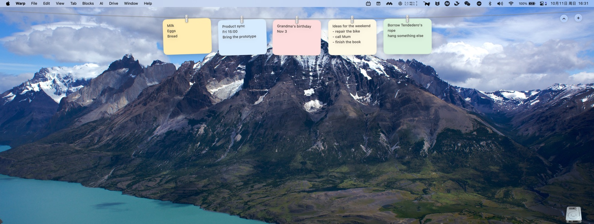

# MemoLine

Notes hung on a clothesline under the macOS menu bar.
Out of sight, within reach.

<p>
  English ·
  <a href="docs/i18n/README.zh-Hans.md">简体中文</a> ·
  <a href="docs/i18n/README.ja.md">日本語</a> ·
  <a href="docs/i18n/README.ko.md">한국어</a> ·
  <a href="docs/i18n/README.es.md">Español</a> ·
  <a href="docs/i18n/README.fr.md">Français</a> ·
  <a href="docs/i18n/README.de.md">Deutsch</a> ·
  <a href="docs/i18n/README.pt-BR.md">Português (Brasil)</a>
</p>

Rest the pointer in the menu bar and the line glides down, cards swaying in the
breeze. Move away and it tucks itself back up. Nothing on your desktop, nothing
to open.

Free, MIT licensed, macOS 13 and later. No account, no network, no permissions.
The app speaks English, 简体中文, 日本語 and 한국어, following your Mac's
language.

<br>

## One gesture each

| Gesture | What it does |
|:--|:--|
| Rest the pointer in the menu bar | The line comes down on that screen |
| Click a card | Write that memo |
| The copy button in the corner | Copy the text — the card flashes "Copied" |
| The cross in the corner | Take the memo down (delete) |
| Drag a card along the line | Reorder it, the others make room |
| Drag a card off the line | Drop the text into another app; the memo stays |
| Right click a card | Edit, copy, new, paper colour, move, take down |
| **＋** at the end of the rope | New memo, editor open |
| **⌃** at the end of the rope | Tuck the line away |
| <kbd>⌃</kbd><kbd>⌥</kbd><kbd>N</kbd> | New memo |
| <kbd>⌃</kbd><kbd>⌥</kbd><kbd>M</kbd> | Show or hide the line (changeable in the menu bar) |
| Two-finger swipe along the line | Scroll through the memos when there are more than fit |
| <kbd>⌘</kbd><kbd>C</kbd> in the editor | Copy, as anywhere else |

The menu bar icon also holds: take everything down, what brings the line down,
how many memos to keep, card size, shortcut, sounds, open at login.

<br>

## Writing

Double-click a card and a small sheet of paper opens under the line, in the
same colour as the card. It saves on every keystroke, so closing it any way at
all keeps the text. The row of dots along the bottom changes the paper, on the
card and in the editor at once.


<br>

## Install

### Download it

Grab `MemoLine.zip` from the [latest release](../../releases/latest), unzip it
and drag **MemoLine.app** into Applications.

The app is signed ad hoc, not with a paid Apple Developer ID, so the first time
macOS will say it cannot verify the developer. Let it through once:

- **macOS 15 or later** — open **System Settings › Privacy & Security**, scroll
to Security, and click **Open Anyway** next to MemoLine.
- **Earlier** — right-click the app and choose **Open**.
- **Or skip the clicking** — `xattr -dr com.apple.quarantine /Applications/MemoLine.app`

After that it opens like any other app. It asks for no permissions at all: no
screen recording, no accessibility, no network.

### Or build it

macOS 13 or later and a Swift toolchain. Xcode is optional.

```sh
git clone https://github.com/xbsheng/MemoLine.git
cd MemoLine
scripts/build-app.sh        # makes build/MemoLine.app, universal
open build/MemoLine.app
```

`swift build && .build/debug/MemoLine` runs it too, without the app bundle.

Check it without a screen, and without touching the memos you are using:

```sh
swift run MemoLine --self-check     # layout, reordering, storage
swift scripts/check-strings.swift   # every language has every string
```

Both run in CI on every push, along with the app bundle build. Tag a commit
`v1.0.0` and CI publishes `MemoLine.zip` as a release.

To have it start with your Mac, drag the app into Applications and turn on
**Open at login** in the menu bar.

### For maintainers: the signing question

The two clicks above are the whole cost of not paying Apple. A Developer ID
certificate ($99/year) plus notarization removes them:

```sh
SIGN_IDENTITY="Developer ID Application: You (TEAMID)" scripts/build-app.sh
# then notarize the zip with notarytool and staple it
```

<br>

## Where the memos live

`~/Library/Application Support/MemoLine/memos.json` — plain JSON, one entry per
memo. Nothing leaves the Mac: no account, no network, no analytics, no special
permissions. The app writes only this file.

<br>

## Inside

| File | What it does |
|:--|:--|
| `App.swift` | Entry point; `--self-check` runs the checks instead of the app |
| `AppDelegate.swift` | Menu bar, shortcuts, bringing the line down and tucking it away |
| `LinePanel.swift` | The transparent strip across the top of the screen |
| `LineView.swift` | The rope, where each card hangs, the two buttons at its end |
| `MemoView.swift` | One card: paper, clip, swing and breeze |
| `GrabArea.swift` | Click, double click, press and hold, dragging, right click menu |
| `Line.swift` | What hangs on the line and what you can do with it |
| `MemoEditor.swift` | The sheet the memo is written on |
| `SelfCheck.swift` | The assertions `--self-check` runs |
| `Resources/*.lproj` | One folder per language; `scripts/check-strings.swift` checks them |

The icon is drawn by code too: `swift scripts/make-icon.swift out.png`.

<br>

## A note on where this comes from

The interaction — screenshots on a clothesline above the menu bar, the rope,
the clips, the sway — is [Tendedero](https://github.com/alejandrobujan/tendedero)
by Alejandro Buján, and this app was built on top of it, MIT licensed. MemoLine
carries its own name and its own icon, as that licence asks, and isn't
affiliated with it.

## License

MIT, see [LICENSE](LICENSE).
