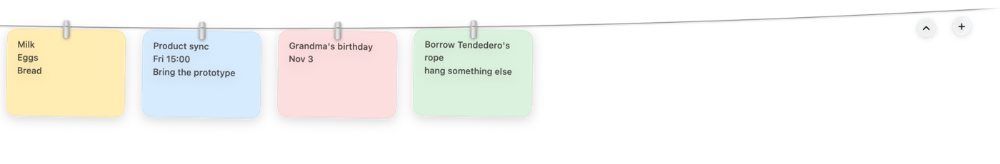
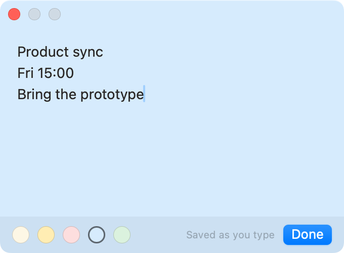

<picture>
  
</picture>

# MemoLine

macOS のメニューバーの下、物干しロープにメモを掛けておく。
見えないけれど、手は届く。

<p>
  <a href="../../README.md">English</a> ·
  <a href="README.zh-Hans.md">简体中文</a> ·
  日本語 ·
  <a href="README.ko.md">한국어</a> ·
  <a href="README.es.md">Español</a> ·
  <a href="README.fr.md">Français</a> ·
  <a href="README.de.md">Deutsch</a> ·
  <a href="README.pt-BR.md">Português (Brasil)</a>
</p>

ポインタをメニューバーにとどめると、ロープがゆっくり降りてきて、メモが揺れます。
離せば、また上のほうへ。デスクトップには何も残らず、開くウィンドウもありません。

無料、MIT ライセンス、macOS 13 以降。アカウント不要、通信なし、権限要求なし。

<br>

## ひとつの動作に、ひとつのこと

| | |
|:--|:--|
| ポインタをメニューバーにとどめる | その画面でロープが降りてくる |
| メモをクリック | そのメモを書く |
| 左上のコピーボタン | 文字をコピー。「コピーしました」が一瞬出る |
| 右上の × | このメモを外す（削除） |
| ロープに沿ってドラッグ | 並べ替え。他のメモが道をあける |
| ロープの外へドラッグ | 文字を他のアプリへ。メモはロープに残る |
| メモを右クリック | 編集・コピー・新規・紙の色・移動・取り外し |
| ロープの端の **＋** | 新しいメモ。そのまま編集が開く |
| ロープの端の **⌃** | ロープをしまう |
| <kbd>⌃</kbd><kbd>⌥</kbd><kbd>N</kbd> | 新しいメモ |
| <kbd>⌃</kbd><kbd>⌥</kbd><kbd>M</kbd> | ロープの表示／非表示（メニューバーで変更可） |
| ロープ上で2本指スワイプ | 画面に入りきらないときのスクロール |
| 編集画面で <kbd>⌘</kbd><kbd>C</kbd> | いつもどおりコピー |

メニューバーのアイコンには、すべて外す・ロープを出すきっかけ・残す枚数・サイズ・
ショートカット・効果音・ログイン時に開く、も入っています。

<br>

## 書く

メモをダブルクリックすると、ロープの下に同じ色の紙が現れます。打つそばから保存されるので、
どう閉じても文字は残ります。下の色の丸を押すと紙が変わり、カードと編集画面が同時に変わります。



<br>

## インストール

[最新リリース](../../releases/latest)から `MemoLine.zip` を落として解凍し、**MemoLine.app** を「アプリケーション」へドラッグします。

Apple の Developer ID を取っていない ad-hoc 署名なので、初回だけ macOS が開発元を確認できないと言います。一度だけ許可してください：

- **macOS 15 以降**：「システム設定 › プライバシーとセキュリティ」の「セキュリティ」で、MemoLine の横の**このまま開く**を押す
- **それ以前**：アプリを右クリックして**開く**
- **クリックしたくない場合**：`xattr -dr com.apple.quarantine /Applications/MemoLine.app`

以後は普通のアプリです。権限は一切要求しません：画面収録も、アクセシビリティも、通信もなし。

### 自分でビルドする

macOS 13 以降と Swift ツールチェーン（Xcode は任意）。

```sh
git clone https://github.com/xbsheng/MemoLine.git
cd MemoLine
scripts/build-app.sh        # build/MemoLine.app（ユニバーサル）を作る
open build/MemoLine.app
```

`swift build && .build/debug/MemoLine` でも動きます。

画面を使わず、いま使っているメモに触れずに確認できます：

```sh
swift run MemoLine --self-check     # レイアウト・並べ替え・保存
swift scripts/check-strings.swift   # 全言語の文字列がそろっているか
```

ログイン時に起動するには、アプリを「アプリケーション」へ移し、メニューバーの
「ログイン時に開く」を入にします。

<br>

## メモの保存先

`~/Library/Application Support/MemoLine/memos.json`。ただの JSON です。
Mac の外には出ません：アカウント不要、通信なし、解析なし、特別な権限も不要。
書き込むのはこのファイルだけです。

<br>

## ライセンス

MIT。[LICENSE](../../LICENSE) を参照。

ロープの仕草——メニューバーの上の物干しロープ、クリップ、揺れ——は Alejandro Buján の
[Tendedero](https://github.com/alejandrobujan/tendedero)（MIT）からで、本アプリはその上に
作られています。そのライセンスに従い、MemoLine は独自の名前とアイコンを使い、
Tendedero とは関係ありません。

<sub>英語版 README の翻訳です。コードの構成は英語版を参照してください。</sub>
